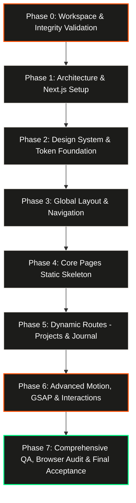

# RAW STRUCTURE — Master Phased Execution Plan

**Folder:** `raw_structure_integrity_playbook`  
**Reference Target:** https://rawstructure.framer.website/  
**Study Mode:** Local-First Architectural Reference Recreation for Study & Technical Benchmarking  
**Status:** Playbook & File Architecture Complete — Ready for Phased Execution

---

## 🎯 Executive Summary & Objective

This execution plan outlines the end-to-end development life cycle for recreating **RAW STRUCTURE** — an ultra-premium, brutalist/industrial construction company website. 

Through live browser analysis and deep asset inspection, we discovered that the target is a **full-scale 17-page web application** featuring:
- **Typography:** Display `Anton`, Subheads `Archivo`, Technical Mono `JetBrains Mono` & `Fragment Mono`, Body `Inter`.
- **Palette:** Industrial Asphalt `#0e0e0d`, Dark Concrete `#1c1c1a`, Safety Orange `#ff4d00`, Off-White Chalk `#e7e3dc`, Aggregate Muted `#8c877f`.
- **Pages:** Home `/`, About `/about`, Services `/services` (with interactive capability metrics & FAQ accordion), Projects Archive `/projects`, 6 Case Studies (`/projects/meridian-tower`, `/projects/kessel-bridge`, `/projects/foundry-lofts`, `/projects/atlas-clinic`, `/projects/northgate-logistics-hub`, `/projects/monolith-house`), Journal Archive `/journal`, 4 Engineering Articles, Contact `/contact`, and `404`.
- **Interactions:** Dual diagonal hazard marquee, horizontal drag-to-explore project gallery, interactive 5-level timeline switcher, animated metric counters, architectural coordinate tracking widget, and a full-screen industrial mobile navigation drawer.

We execute in **disciplined, gated phases**. After each phase is implemented, we pause to discuss the results, verify screenshots/tests, and gain alignment before proceeding to the next step.

---

## 🗺️ The 8-Phase Step-by-Step Implementation Roadmap

---

### Phase 0: Workspace & Playbook Alignment (Current State)
- **Goal:** Audit all playbook files, eliminate placeholders, incorporate live data, and confirm project structure.
- **Deliverables:**
  - Complete `raw_structure_integrity_playbook` directory.
  - 11 high-res captured screenshots in `screenshots/`.
  - `docs/full_site_inventory.md` and `docs/search_index.json` with all 17 pages' content.
  - Fully articulated specifications (`ARCHITECTURE.md`, `DESIGN_SYSTEM.md`, `ANIMATION_SPEC.md`, `REFERENCE_AUDIT.md`, `ASSET_REGISTER.csv`).
- **Discussion Checkpoint 0:** Confirm playbook file structure and alignment with user before scaffolding project code.

---

### Phase 1: Next.js App Router, Tooling & Asset Ingestion
- **Goal:** Initialize a clean Next.js project with TypeScript, Tailwind CSS, App Router, and ingest all verified production assets.
- **Action Steps:**
  1. Scaffold Next.js in a dedicated project directory (e.g., `raw-structure-study/`).
  2. Configure `tsconfig.json`, `next.config.ts`, `postcss.config.mjs`, and Tailwind CSS configuration.
  3. **Ingest Verified Production Assets:**
     - Copy all 21 production JPEGs from `raw-structure-construction-engineering.assets.Woblo/` into `public/images/`.
     - Copy all 20 production WOFF2 font files from `raw-structure-construction-engineering.assets.Woblo/fonts/` into `public/fonts/`.
     - Copy all 27 vector SVGs (blueprint grids, symbols) from `raw-structure-construction-engineering.assets.Woblo/` into `public/svgs/`.
     - **Strict Rule:** Zero placeholders, zero AI image generation, zero external CDN dependencies. Only verified local assets are used.
  4. Install core dependencies: `gsap`, `@gsap/react`, `lucide-react`, `clsx`, `tailwind-merge`.
  5. Verify development server starts cleanly on local port (`npm run dev`).
  6. Verify zero TypeScript errors (`npx tsc --noEmit`).
- **Discussion Checkpoint 1:** Review package structure, asset ingestion checklist, dependencies, and clean dev server run.

---

### Phase 2: Design System, Tokens & Local Typography Foundation
- **Goal:** Establish the complete visual DNA and styling foundation using local production fonts before writing UI components.
- **Action Steps:**
  1. Configure local `@font-face` declarations in `globals.css` pointing directly to local `public/fonts/` (`Anton` `PCXT6E5Y...`, `Archivo` `7BTLO3Z...`, `JetBrains Mono` `EO5MKE3...`, `Inter` `5vvr9V...`).
  2. Create `src/styles/tokens.css` with exact hex colors (`--bg: #0e0e0d`, `--surface: #1c1c1a`, `--accent: #ff4d00`, `--text: #f6f4f0`, `--border: rgba(231,227,220,0.14)`).
  3. Implement Tailwind utility extensions for brutalist borders, architectural grids (`svg-1.svg`), and typography presets.
  4. Create base UI atoms: `Button` (compound rectangular button with separate black ↗ arrow box), `Badge` / `Tag` (mono spec labels), `Container` (1320px max-width, responsive padding).
- **Discussion Checkpoint 2:** Inspect rendered typography specimens, color token preview, and asset rendering in browser.

---

### Phase 3: Global Shell, Navigation & Sticky Architectural HUD
- **Goal:** Build the site-wide framework that wraps every page.
- **Action Steps:**
  1. Implement `SiteHeader`:
     - Desktop: Fixed top navigation with raw typography logo, capsule link group (`About`, `Services`, `Projects`, `Journal`, `Contact`), and "Start a project" CTA.
     - Mobile: Hamburger toggle button and full-screen industrial slide-out drawer with contact specs.
  2. Implement `ArchitecturalHUD` (Fixed right coordinate widget: `N 51°54' / E 4°28' — ROTTERDAM HQ`).
  3. Implement `SiteFooter`:
     - Large typography signoff ("Got a site? Let's build something that stands.").
     - 4-column metadata grid: (01) Head office, (02) Talk to us, (03) Sitemap, (04) Follow the build.
     - Sub-footer with ISO 9001 / ISO 45001 badges, copyright 2026, and time indicator.
- **Discussion Checkpoint 3:** Test desktop navigation, sticky header scroll behavior, and mobile drawer open/close.

---

### Phase 4: Core Landing Pages — Static Layout Skeleton
- **Goal:** Build pixel-accurate static sections for the core pages with real text and layout.
- **Action Steps:**
  1. **Home (`/`)**:
     - Hero: Dual headline ("We build what stands.", "Drawing → Landmark"), discipline ticker tags, coordinate badges.
     - (01) Who we are: Mission statement and developer trust stats.
     - (02) What we do: 5 discipline cards with numbers `01`-`05`.
     - (03) How we build: 5-level timeline ("Level 00" to "Level 04", Week 0-4 to Month 18+).
     - (04) Selected work: Gallery grid cards.
     - (05) Metrics & Client words: 4 stat blocks (`38+` Years, `214+` Projects, `1.2M` Safe Hours, `640+` People) + 3D building model left + testimonials.
     - (06) Site Office Journal preview: 3 recent technical notes.
  2. **About (`/about`)**:
     - "BUILT BY BUILDERS" manifesto, history timeline 1987-2026, safety values, leadership.
  3. **Services (`/services`)**:
     - 5 engineering discipline deep-dives, (02) Capability Sheet technical specs, (03) FAQ accordion.
  4. **Contact (`/contact`)**:
     - Form RS-01 (Site enquiry specification), direct phone/email, Rotterdam HQ coordinates.
- **Discussion Checkpoint 4:** Review side-by-side screenshot comparisons of Home, About, Services, and Contact against reference screenshots.

---

### Phase 5: Dynamic Case Studies & Journal Articles
- **Goal:** Populate the dynamic data model and build individual case study and journal templates.
- **Action Steps:**
  1. Create typed data sources in `src/data/`:
     - `projects.ts` (Meridian Tower, Kessel Bridge, Foundry Lofts, Atlas Clinic, Northgate Logistics, Monolith House).
     - `journal.ts` (Why we pour concrete at night, Reading a site, Mass timber vs steel, Zero incidents).
  2. Build `/projects` index (filterable gallery) and `/projects/[slug]` dynamic case study route:
     - Blueprint metadata banner (Location, Year, Typology, Height/Span, Structural Engineer).
     - Project narrative: The brief, Engineering challenge, How we built it, The result.
     - Technical specifications table.
  3. Build `/journal` index and `/journal/[slug]` dynamic article route:
     - Category badge, publication date, reading time.
     - Rich editorial typography with callout quotes and field notes summary.
  4. Implement custom `not-found.tsx` (`/404`) with architectural grid.
- **Discussion Checkpoint 5:** Verify dynamic page routing, metadata generation, and content accuracy across all 10 dynamic subpages.

---

### Phase 6: GSAP ScrollTrigger, Marquees & Interactive Micro-Animations
- **Goal:** Layer in the fluid animations that give RAW STRUCTURE its signature high-end feel.
- **Action Steps:**
  1. Implement Dual Diagonal Marquee (`Marquee.tsx`):
     - Infinite CSS/GSAP ribbon running at calibrated speed with pause-on-hover.
  2. Implement Horizontal Drag / Slider for Selected Work:
     - Touch/pointer drag support with smooth momentum and indicator cursor ("Drag to explore →").
  3. Implement Interactive How We Build Timeline Switcher:
     - Clicking or scrolling through levels activates the corresponding phase card with smooth cross-fades.
  4. Implement Animated Metric Counters:
     - Scrubbed or triggered count-up from 0 to target numbers when scrolled into view.
  5. Implement FAQ Accordion:
     - Smooth spring height expand/collapse with plus-to-minus icon morph.
  6. Accessibility & Reduced Motion:
     - Verify `@media (prefers-reduced-motion: reduce)` disables all continuous scroll scrubs and replaces them with instant reveals.
- **Discussion Checkpoint 6:** Inspect animation fluidness, verify no ScrollTrigger pin jumps or duplicate listeners, and test reverse scrolling.

---

### Phase 7: Complete Multi-Device QA, Performance & Acceptance
- **Goal:** Rigorous verification across all viewports and browsers to ensure 100% polish.
- **Action Steps:**
  1. Viewport Matrix Testing:
     - Desktop Wide: 1440 × 900
     - Laptop: 1280 × 800
     - Tablet: 768 × 1024
     - Mobile: 390 × 844
  2. Console & Hydration Audit: Verify zero React hydration warnings, zero missing asset errors, zero CSS overflow.
  3. Production Build Validation: Execute `npm run build` and ensure all 17 routes compile to static/server-rendered outputs cleanly.
  4. Generate final visual comparison and test report in `docs/test-results.md`.
- **Discussion Checkpoint 7:** Final walkthrough of the cloned website and signoff.

---

## 📌 Rules of Engagement & Collaboration

1. **Step-by-Step Transparency:** We execute one phase at a time. After completing each phase, we stop, report exact files created, show evidence, and wait for your review and approval before starting the next phase.
2. **No Assumptions:** Every piece of copy, typography style, color token, and animation parameter is verified against the real live site artifacts we inspected.
3. **Local Safety:** Everything runs locally on your laptop in development mode. Zero external deployments or credential requirements.
